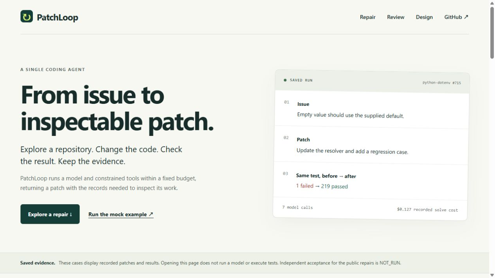
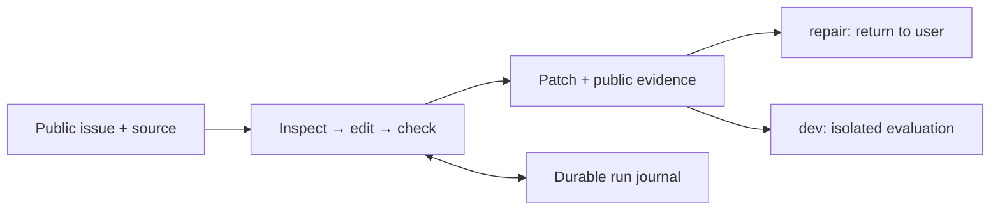

# PatchLoop

**A single coding agent that reads an issue, repairs a repository, and checks its work within a fixed budget.**

[](https://github.com/woojune511/patchloop-agent/actions/workflows/ci.yml)

[See a repair](https://woojune511.github.io/patchloop-agent/) ·
[Design decisions](docs/product.md#design-choices-and-costs) ·
[Results and limits](docs/evidence.md) · [Run locally](#try-it-without-an-api-key)

[](https://woojune511.github.io/patchloop-agent/)

PatchLoop explores source, edits code, and returns a patch with check results.
Its runtime manages context, budget, interruption recovery, and isolated evaluation.

## A real repair, with the original evidence

For **python-dotenv #715**, the agent added a regression case for an empty
environment variable and changed the default-value resolver.

| Same model-written test | Recorded result |
| --- | --- |
| Added to the original implementation | 1 failed, 218 passed |
| With the returned implementation | 219 passed |

The saved solve used 7 model calls, USD 0.12695715, and 98.97 seconds of CLI time,
excluding preparation and external verification. The test covers an empty
environment variable; the issue's empty file value was checked separately.
Independent acceptance is **NOT_RUN**. These are saved results, not a live demo.

[Walkthrough](https://woojune511.github.io/patchloop-agent/#repair) ·
[Original patch](examples/saved-repair/returned.patch) ·
[Verification JSON](examples/saved-repair/verification.public.json) ·
[Provenance and reproduction](examples/saved-repair/README.md)

## How the agent works



The model chooses bounded tools. Private tests and reference patches stay outside
its context. Public checks alone do not establish task acceptance.

| Engineering decision | Problem it addresses | Tradeoff / implementation |
| --- | --- | --- |
| Bind checks to the exact diff | A previous PASS must not validate a later edit | Extra rechecks; [tool gateway](patchloop/dev/tools.py) |
| Recover actions by ID and input hash | Restarting must not repeat a completed edit or check | Uncertain state stops recovery; [journal](patchloop/dev/state.py) |
| Admit cost immediately before a call | Work must fit the remaining invocation budget | A run may stop before solving; [cost admission](patchloop/dev/cost.py) |

[Architecture and contract tests](docs/product.md)

## What a passing test missed

In **Click #2786**, the first patch fixed a value overwrite, but skipped callback
validation for an omitted option. Public review reproduced that regression. The
agent then corrected the patch using the supplied feedback, preserving callback
processing and restricting the overwrite instead.

Across three saved public uses, all original red/green comparisons passed; review
found one scoped candidate and two patches needing changes. Corrections are
recorded separately from first attempts. Human final approval is unreported.

[Original and corrected patches](examples/reviewed-repairs/README.md) ·
[Explore the review case](https://woojune511.github.io/patchloop-agent/#review)

## Evaluation checkpoints

| Recorded development panel | PASS / FAIL / NOT_RUN | Model-call cost | Scope |
| --- | --- | --- | --- |
| [2026-10-06 dev20](examples/portfolio-dev20/README.md) | 9 / 11 / 0 | USD 3.46111455 | Frozen remeasurement; historical result 10/20 |
| [2026-10-16 dev20](docs/history/2026-10-16-patchloop-mini-dev20-results.md) | 8 / 10 / 2 | USD 7.01172285 | Later runtime; two tasks stopped at row cost caps |

These are development-exposed tasks under different recorded conditions, not a
held-out score or a causal comparison. Every run is `official=false`; general repair
improvement has not been established. [Evidence boundaries](docs/evidence.md) and
[current decisions](docs/current-status.md) preserve failures and closed experiments.

## Try it without an API key

Requires Git, Python 3.12+, and [uv](https://docs.astral.sh/uv/).
Install the locked dependencies:

```sh
git clone https://github.com/woojune511/patchloop-agent.git
cd patchloop-agent
uv sync --extra dev --locked
```

PowerShell:

```powershell
$env:PATCHLOOP_STATE_ROOT = Join-Path $env:TEMP ('patchloop-' + [guid]::NewGuid().ToString('N'))
uv run --locked patchloop dev --provider mock --task tasks/smoke/csv-quoted-newline/public.yaml --model mock-dev --repeat 1
```

Linux / macOS:

```sh
export PATCHLOOP_STATE_ROOT="$(mktemp -d)/state"
uv run --locked patchloop dev --provider mock --task tasks/smoke/csv-quoted-newline/public.yaml --model mock-dev --repeat 1
```

This scripted smoke checks the tool loop through isolated evaluation, without a
model service or Docker. Inspect the returned result and artifacts under
`PATCHLOOP_STATE_ROOT`; mock evaluation is not autonomous repair or Docker safety
evidence. See [public repair](examples/repair/README.md) for patch delivery and
[operations](docs/operations.md) for tests, result fields, and approved live runs.

## Read the code

- [Agent loop](patchloop/dev/runner.py), [model context](patchloop/dev/model_state.py), and [tools](patchloop/dev/tools.py)
- [Public repair](patchloop/repair.py) and [before/after test comparison](patchloop/repair_verification.py)
- [Runtime and recovery tests](tests/) · [Documentation index](docs/README.md)

Cross-run memory, held-out tuning, and claim execution are disabled. Historical
records under `docs/history/` are evidence, not current runtime instructions.
